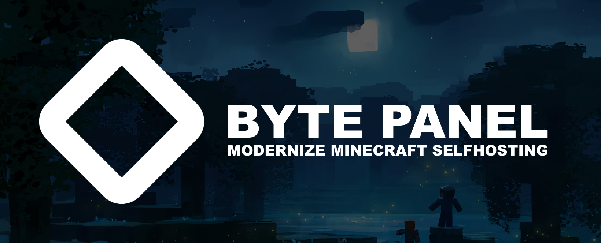

[GitHub](https://github.com/NotSpookyGhost/Byte-Panel) ·
[Report an issue](https://github.com/NotSpookyGhost/Byte-Panel/issues) ·
[Build version](version.txt)

## Overview

Byte Panel is a self-hosted Minecraft Java Edition server panel for Docker and
Unraid. Each container manages one server, with persistent files and settings in
its `/data` volume.

## Features

- **Server engines:** Vanilla, Paper, Purpur, Fabric and Forge, with live version
  lists and automatic Java selection.
- **Server controls:** Start, stop, restart, optional startup/crash recovery,
  console command history, logs, players and server properties.
- **Plugins:** Upload/delete Paper and Purpur plugins, upload plugin data files,
  and edit/search text configs.
- **Backups:** Manual and scheduled ZIP backups, optional shutdown during backup,
  downloads, manual-backup renaming, restores and imports.
- **Accounts:** Owner protection, administrator/custom permissions and separate
  backup creation, restore and import permissions.
- **Invitations:** SMTP welcome/password emails, customizable templates and
  temporary passwords that must be changed on first login.
- **Customization:** Server icon/name, appearance settings and public BlueMap
  access through `/map`.

## Using the panel

### Everyday controls

Choose the engine, Minecraft version and RAM during setup, or import a server ZIP.
Available Minecraft versions depend on the engine.

Use **Overview** for server controls, **Console** for commands, **Logs** and
**Players** for activity, and **Properties** for Minecraft settings. Click your
sidebar username to open **My Account**.

Console commands do not need a leading `/`: try `help`, `plugins` or
`say Hello World`. Existing prefixes, including `//`, are preserved.
**↑ / ↓** recall up to 100 recent commands; moving past the newest restores your
unfinished draft. Press **Enter** or **Send** to run a recalled command.
History stays in the current page and clears when you refresh or leave it.

CPU and memory readings describe the server process. TPS is not currently measured.

### Panel Settings

| Section | What you configure |
| --- | --- |
| **General** | Server name and server icon |
| **Runtime** | Java, timezone and automatic startup/crash recovery |
| **Backups** | Schedule, retention and shutdown during backup |
| **Addons** | Public BlueMap integration |
| **Appearance** | Theme, accent, favicon and background |
| **Email** | SMTP delivery and invitation settings |
| **Operations** | Backup, import and owner-only purge/reset |

Use **Save Settings** or **Apply Changes** to save changes. SMTP has its own save
button. Changing settings does not automatically restart Minecraft.

**Server icon:** Upload a PNG, JPEG or WebP in General (up to 5 MiB and 16 million
pixels). The panel fits it into a 64×64 PNG for the login screen, sidebar server
badge, welcome email and Minecraft multiplayer list. Restart Minecraft for the
in-game change. The top-left Byte Panel logo always stays white and unchanged.

**Automatic startup/recovery:** Both Runtime options are off by default.
Auto-start starts Minecraft once when the panel/container starts. Crash recovery
retries unexpected non-zero exits after 10 seconds, stopping after three attempts
within five minutes. After that, inspect the logs and press **Start** manually.
**Stop**, console `stop` and clean exits stay stopped.
If auto-start remains enabled, a later container restart starts Minecraft again.
Import, restore and purge disable both options. These settings do not restart
Docker or detect a hung process.

### Plugins and config files

The **Plugins** tab is available on **Paper and Purpur**.

1. Upload plugin JARs (up to **64 MiB**), then restart Minecraft to generate configs.
2. Open a plugin folder to upload presets, exports or other non-JAR files (up to
   **64 MiB**). The upload form shows the destination.
3. Open supported text configs (up to **1 MiB**), use **Find in config** or
   Ctrl/Cmd+F, edit and save.

For LuckPerms, upload `preset.json.gz` into `plugins/LuckPerms`, then run
`lp import preset.json.gz` in the console. Uploading a file does not import or
unpack it automatically.

Root-folder non-JAR uploads are limited to supported text configs up to 1 MiB.
Deleting a plugin JAR keeps its config folders. Previous files are saved under
`/data/plugin-config-backups` before config saves, replacements and JAR deletions.
Stop Minecraft before replacing files in use; restart after changing plugin JARs.

### Backups, imports and resets

Use **Backups** to create, download or restore ZIP archives. Manual backups can
also be renamed; automatic backup names are fixed. Names already in use cannot
be overwritten. The active server's backups are grouped separately from other
servers' archives.

Set scheduling and retention under **Panel Settings → Backups**. New archives
appear after creation and verification finish. Failed creation leaves existing
archives intact.

For consistent world and plugin data, enable **Shut down server during backups**
or stop Minecraft yourself before backing up. Shutdown mode gracefully stops a
running server, verifies the ZIP and restarts it; an already-offline server stays
offline. This applies to manual and scheduled backups and disconnects players;
users with backup-creation permission can trigger that downtime. It is off by
default and reduces snapshot inconsistency, not existing corruption.

Shutdown backups abort if Minecraft cannot stop cleanly within three minutes;
the panel does not force-kill it. After a clean stop, restart is attempted even
if archiving fails. If restart fails, a completed ZIP is retained and the error
is reported. Avoid external watchdogs or plugins that restart Minecraft during
a shutdown backup. Start/stop/restart, console commands, settings changes, restore,
import and purge are blocked while a backup runs. Avoid other file changes.

Backups carry the server's **`ServerEngineInfo`** file at the ZIP root. It records
the Minecraft version, engine/source, RAM and recorded launch settings so Byte
Panel can identify an imported server. Keep it intact when moving backups.
ZIPs without it require manual version, engine and RAM selections during import.

- **Restore/import:** Replaces the active server, preserves the original owner
  and acting user, removes other panel accounts and revokes existing sessions.
  Stop Minecraft before restoring. Import is under **Settings → Operations**.
- **Purge & Reset:** Original setup owner only. Deletes the active server,
  server icon, panel accounts and player history; keeps existing backups,
  panel appearance assets and SMTP settings, then returns to setup.
- **Container updates/restarts:** Keep accounts and server data when the same
  `/data` volume is used.

Minecraft ZIP backups exclude panel accounts, session keys and SMTP credentials.
Back up the entire `/data` directory to protect the complete installation.

### Accounts, invitations and email templates

Configure **Panel Settings → Email** first: enable SMTP, enter the connection
details, sender and public panel URL, enable automatic new-user emails, then
save and send a test. A blank password field keeps the saved password.
For Gmail, use `smtp.gmail.com`, port **587**, **STARTTLS**, your full email
address and a [Google app password](https://support.google.com/accounts/answer/185833).

Open **Panel Users** to create users and assign permissions. When automatic
invitations are enabled and the account has an email address, the welcome email
is followed by a separate temporary-password email about **12 seconds** later.
Actual arrival order depends on the mail provider. Temporary passwords expire
after **24 hours** and must be changed on first login; resending an invitation
invalidates the previous temporary password.

Passwords require **12–256 characters**, at least one uppercase letter, a number
and an ASCII punctuation symbol such as `!`, `@` or `#`.
Grant console, file, restore and user-management access only to trusted users.

Customize [welcomeTemplate.json](templates/welcomeTemplate.json) and
[passwordTemplate.json](templates/passwordTemplate.json):

| Placeholder | Meaning |
| --- | --- |
| `{{servername}}` | Server name from General settings |
| `{{username}}` | Account username |
| `{{login_url}}` | Sign-in link |
| `{{expires}}` | Temporary-password expiry |
| `{{password}}` | Temporary password — password email only |
| `{{server_icon}}` | Welcome-email **Image block URL**, not a text placeholder |

The welcome icon is embedded in the email; a missing/invalid icon is omitted.
Update the [plain-text fallbacks](app/templates/emails/) when changing wording,
then rebuild and recreate the container. Templates are JSON design files, not
an in-panel editor. Check inbox/spam and SMTP settings before resending.

### Public BlueMap

1. Install a compatible [BlueMap plugin/mod](https://bluemap.bluecolored.de/wiki/getting-started/Installation.html)
   and configure its webserver inside the Minecraft container.
2. Open **Panel Settings → Addons → BlueMap**, enable the public map, enter the
   matching internal port (default **8100**) and save.
3. Use the sidebar **Map** link or append `/map` to your panel URL:
   `http://SERVER-IP:5000/map` or `https://your-panel.example/map`.

No extra Docker port mapping or Cloudflare tunnel hostname is needed when the
existing route forwards all panel paths. BlueMap must be running; the panel
proxies it but does not install it or render maps.

The map is **public without a panel account**, including any world/player details
BlueMap exposes. Existing Cloudflare Access policies still apply. Use trusted
BlueMap scripts/addons because the map shares the panel's website origin.
Purge, import and restore disable public map access until you enable it again.

## Installation

You need Docker, Git and enough RAM for Minecraft plus the host and other services.
The image is built locally; no Compose file is required.

### 1. Download and build

```sh
git clone https://github.com/NotSpookyGhost/Byte-Panel.git
cd Byte-Panel
docker build --pull -t mc-panel-build:latest .
```

Already have the source? Build from the folder containing `Dockerfile`.
The image includes Java 8, 11, 17, 21 and 25.

### 2. Create a new container

```sh
docker run -d \
  --name byte-panel \
  --restart unless-stopped \
  -p 5000:5000 \
  -p 25565:25565 \
  -v /mnt/user/appdata/byte-panel:/data \
  mc-panel-build:latest
```

Replace the Unraid example path with your persistent host data directory,
separate from the source folder. To use panel port **5050** instead, change
`-p 5000:5000` to `-p 5050:5000`. Minecraft uses port **25565** by default.

### 3. Complete setup

Open `http://SERVER-IP:5000` (or your chosen host port), create the owner account
and configure the server. Restrict access to your trusted network until setup is
complete. Use HTTPS through a trusted reverse proxy for remote access.

### Updating

Back up `/data` and any customized source/templates, get the updated source, then
run `docker build --pull -t mc-panel-build:latest .` again.

**Recreate the container** using the new image, preserving its ports, environment
variables and **the same `/data` mapping**. Restarting the old container alone does
not load the new image. Check the version in the panel footer; no server purge or
world rebuild is needed.
